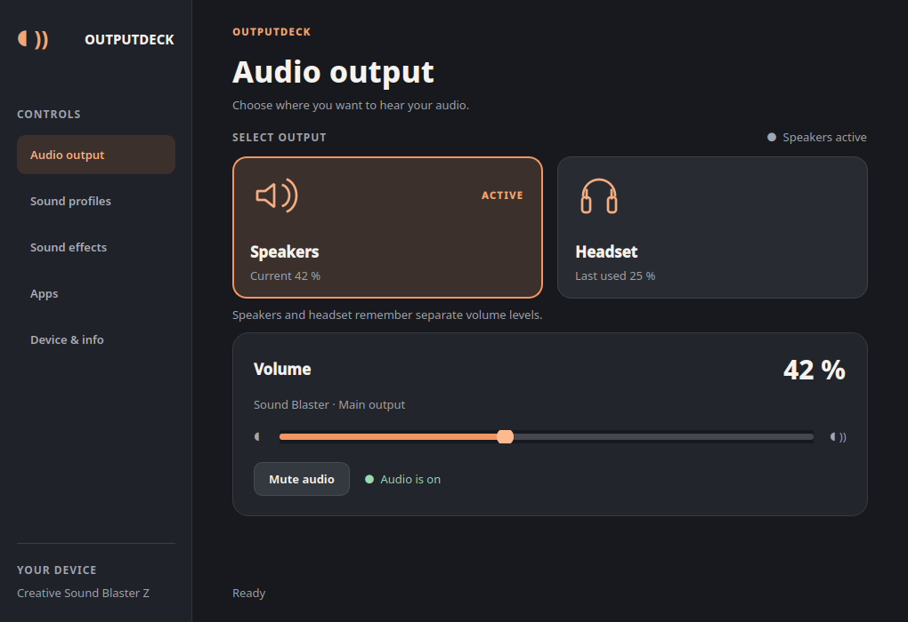

# OutputDeck

An independent Linux app for the **Creative Sound Blaster Z**. Switch between
speakers and headphones using the card's hardware output selector.



## Features

- One-click output switching with separate remembered volume levels.
- Main and per-app volume and mute controls.
- Sound effects, equalizer presets, and three saved profiles.
- English/German interface and an optional KDE global shortcut.

## Requirements

Creative Sound Blaster Z with the CA0132 driver and ALSA `Output Select` control.
Other cards are untested. Requires Linux, Python 3.10+, `amixer`, `pactl`, and
PipeWire or PulseAudio. The optional shortcut requires KDE Plasma and `busctl`.

## Install

```bash
./install.sh
~/.local/bin/outputdeck
```

The installer adds an app-menu launcher and command for your user account.
You can remove the downloaded folder afterward. To enable a shortcut, open
**Device & info**, press a key combination, and click **Enable shortcut**.

## Test or remove

```bash
python3 -m venv .venv
.venv/bin/python -m pip install -r requirements.txt
.venv/bin/python -m unittest discover -s tests
./uninstall.sh
```

Uninstall removes the app and launcher; settings stay in place. Installing an
update keeps existing shortcuts and key combinations.

## License

[MIT License](LICENSE). You can use, modify, and share the app, including for
commercial purposes, as long as you keep the license notice.
